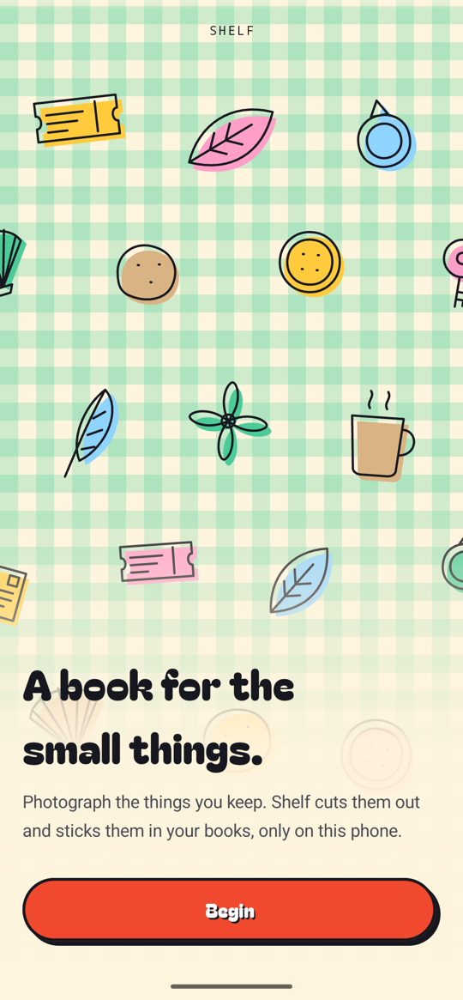
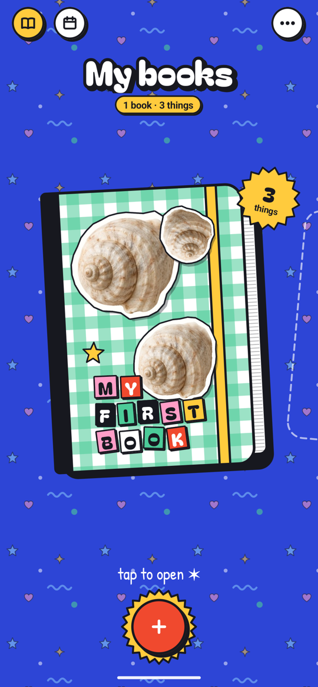
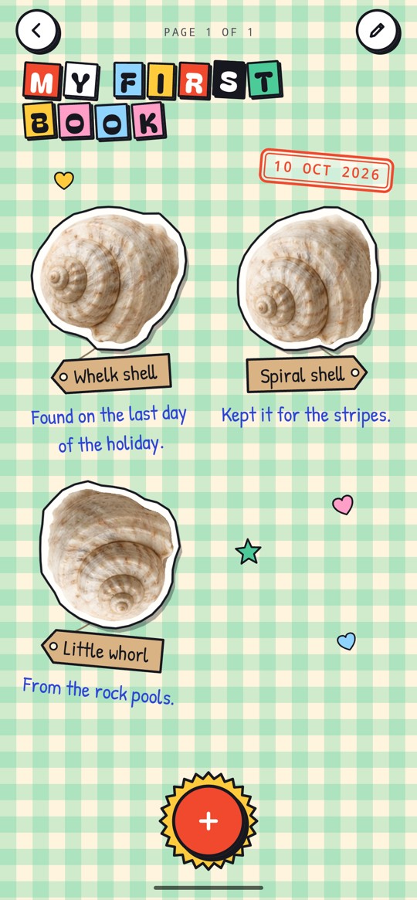
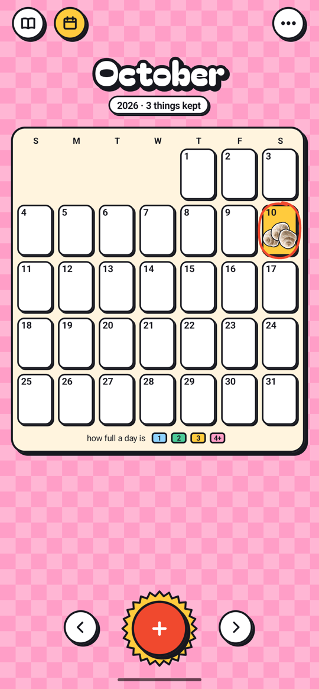
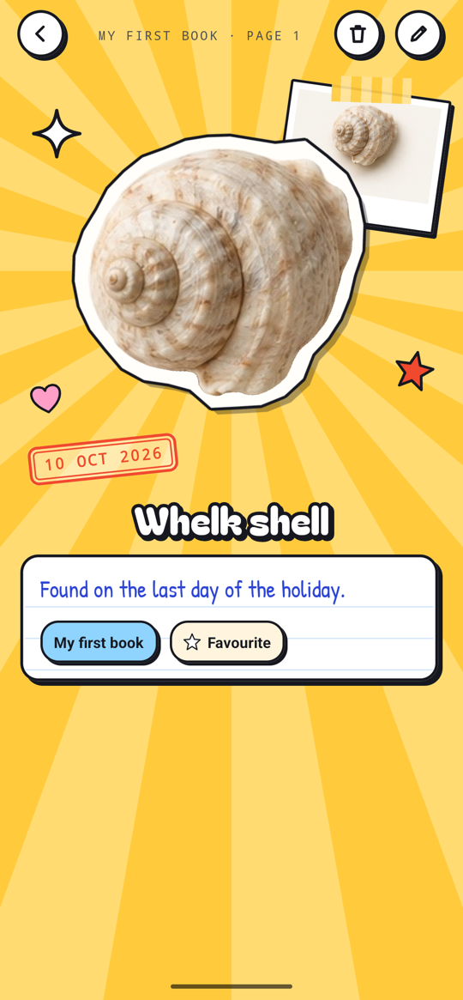
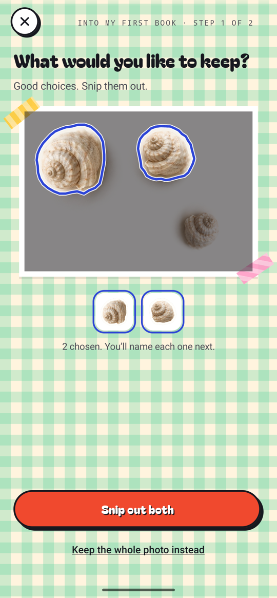
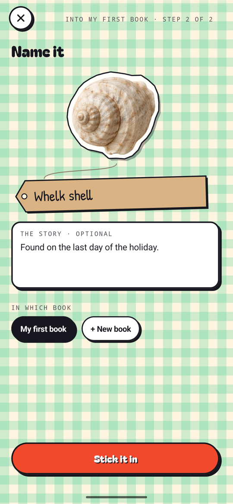

<p align="center">
  
</p>

<h1 align="center">Shelf</h1>

<p align="center"><strong>A quiet place for the things you kept.</strong></p>

<p align="center">
  
  
  
  
</p>

<p align="center">
  <a href="https://github.com/ShobhanKarthish/shelf/releases">Download</a> ·
  <a href="#build-from-source">Build from source</a> ·
  <a href="CONTRIBUTING.md">Contribute</a>
</p>

---

Shelf is a native Android app for keeping the small things that matter: a ticket, a shell, a key. Photograph an object and Shelf cuts it out on your phone, like a sticker. Give it a name and a story if you like, and stick it into a book.

| Welcome | Your books | A page | The calendar |
| :---: | :---: | :---: | :---: |
|  |  |  |  |
| **A thing's page** | **Choose** | **Name it** | |
|  |  |  | |

## Features

- **Cut-outs on your phone.** ML Kit subject segmentation finds the objects in a photo and draws a dashed cut line around each. Tap one, or press and hold, then **Snip it out**. When a photo holds a single object, it is selected for you.
- **Whole photos too.** Keep the full photo as a print, by choice or when an object can't be separated.
- **Books.** Things go into books you swipe between on a desk. Each book has a bold pattern on its cover, its own things stuck on the front and its name in cut-out letters. Tap it and the cover swings open.
- **Pages that fill up.** Four things to a page, each with its name on a kraft tag and the start of its story in pen. Drag a page and it turns around the spine like paper, or use the arrows.
- **Arrange a page.** Drag things, twist them, and choose the book's pattern: grid, dots, stripes, checker or gingham.
- **A calendar.** Each day shows the things kept on it, fanned or piled by how many there are, and lights up by how full it was. Tap a day and its things jump out onto a sheet of their own.
- **A page for each thing.** The sticker in its own sunshine, the photo it was cut from, its date and its story. Mark it a favourite, or edit, move or delete it from there.
- **Things that move when you touch them.** Buttons press down onto their shadows, stickers peel up, tags swing, stamps thunk and adding throws a handful of doodles. Nothing moves on its own.
- **Private by design.** No account and no uploads. Photos and details stay in app-private storage.
- **Accessible.** Screen reader labels, buttons as an alternative to every gesture, 48 dp touch targets, and no motion when system animations are off.

## Download

Get the latest APK from [GitHub Releases](https://github.com/ShobhanKarthish/shelf/releases). Shelf needs Android 9 or later, and Google Play services for background removal.

| APK | What it is |
| --- | --- |
| `shelf-<version>.apk` | The standard release, signed with Shelf's release key. |
| `shelf-<version>-debug-upgrade.apk` | Updates an earlier development build and keeps its books. |
| `shelf-<version>-preview.apk` | Installs next to Shelf as **Shelf Preview**, with its own shelf. |

> [!WARNING]
> Uninstalling Shelf or clearing its storage deletes your collection. There is no export or backup yet.

The segmentation model downloads through Google Play services the first time it is needed. After that, background removal works offline.

## Build from source

### Requirements

- JDK 17
- Android SDK Platform 35 and Build Tools 35.0.0
- A device or emulator running Android 9 or later, with Google Play services

### Build and run

```sh
git clone https://github.com/ShobhanKarthish/shelf.git
cd shelf
```

Open the project in Android Studio, or set `JAVA_HOME` to your JDK 17 installation and create a `local.properties` file with your SDK location:

```properties
sdk.dir=/absolute/path/to/Android/sdk
```

Then build, install and launch:

```sh
./gradlew assembleDebug
adb install -r app/build/outputs/apk/debug/app-debug.apk
adb shell am start -n com.shobhankarthish.shelf/.MainActivity
```

### Build variants

| Variant | Command | Notes |
| --- | --- | --- |
| Debug | `./gradlew assembleDebug` | Debuggable, and noticeably slower. |
| Preview | `./gradlew assemblePreview` | Release speed with the debug key; installs as **Shelf Preview**. |
| Release | `./gradlew assembleRelease` | Needs the release key; see below. |

### Signing a release

Keep the keystore and its signing properties outside the repository:

```properties
storeFile=/absolute/path/to/release.jks
storePassword=your-keystore-password
keyAlias=shelf-release
keyPassword=your-key-password
```

```sh
SHELF_SIGNING_PROPERTIES=/absolute/path/to/release-signing.properties ./gradlew assembleRelease
```

Back up the keystore and credentials securely: every future update must be signed with the same key. Never commit them. Increase `versionCode` in `app/build.gradle.kts` for every release; version `0.5.2` uses version code `8`.

A release-signed APK cannot update a debug-signed installation. Use the matching `debug-upgrade` APK to update a development build without losing its books.

## Testing

Run lint:

```sh
./gradlew lintDebug
```

Run the instrumentation tests on a device or emulator with Google Play services:

```sh
./gradlew assembleDebug assembleDebugAndroidTest
adb install -r app/build/outputs/apk/debug/app-debug.apk
adb install -r app/build/outputs/apk/androidTest/debug/app-debug-androidTest.apk
adb shell am instrument -w com.shobhankarthish.shelf.test/android.test.InstrumentationTestRunner
```

The tests use the real segmentation model, so let its first download finish on a fresh device before running them. They cover single and multiple-object segmentation, tap and long-press selection, snipping, sticker outlines, persistence, and restoring a draft after the activity is recreated.

On a slow emulator the test runner can time out while it scans for tests. Run one class at a time instead:

```sh
adb shell am instrument -w -e class com.shobhankarthish.shelf.SelectionTest com.shobhankarthish.shelf.test/android.test.InstrumentationTestRunner
```

## Project structure

Shelf uses Kotlin, native Android views, SQLite and ML Kit subject segmentation, with no other libraries. Everything lives in `app/src/main/java/com/shobhankarthish/shelf/`:

| File | What it does |
| --- | --- |
| `MainActivity.kt` | Every screen: the desk, pages, the calendar, a thing's page, and adding, editing and saving. |
| `BookViews.kt` | Round buttons, pages and the page turn, covers, and a thing on its page. |
| `Calendar.kt` | The month, its day cells and the sheet a day's things come out onto. |
| `Motion.kt` | The press, doodle bursts, outlined titles, the count badge and the desk, calendar and sunshine backgrounds. |
| `Scrap.kt` | Book patterns, outlined cards and stickers, tape, stamps, kraft tags, pen notes and cut-out letters. |
| `SubjectSelectionView.kt` | The photo, its cut lines, tap selection and the snip animation. |
| `Stickers.kt` | Cuts stickers on background threads and caches them. |
| `Welcome.kt` | The drawn keepsakes on the welcome screen. |
| `CollageViews.kt` | Buttons, sticker views and other shared components. |
| `Collage.kt` | Palette, fonts, icons, doodles and the scissors. |
| `ShelfStore.kt` | Local storage for books, things, their images, favourites and where they sit on a page. |

## Current limitations

Shelf is in early development. Camera capture and export are not available yet, and collections are meant to be small. Imported images are scaled to a maximum long edge of 1600 pixels. Selection only separates objects the model detects separately, so touching or overlapping objects can come out as one.

## Contributing

Bug reports and focused pull requests are welcome. See [CONTRIBUTING.md](CONTRIBUTING.md) for the development workflow.

## Credits

Titles are set in [Bagel Fat One](https://fonts.google.com/specimen/Bagel+Fat+One) by the Bagel Fat Project Authors, and anything you write in [Patrick Hand](https://fonts.google.com/specimen/Patrick+Hand) by Patrick Wagesreiter. Both are under the SIL Open Font License; their license notices are in [licenses/](licenses/).
